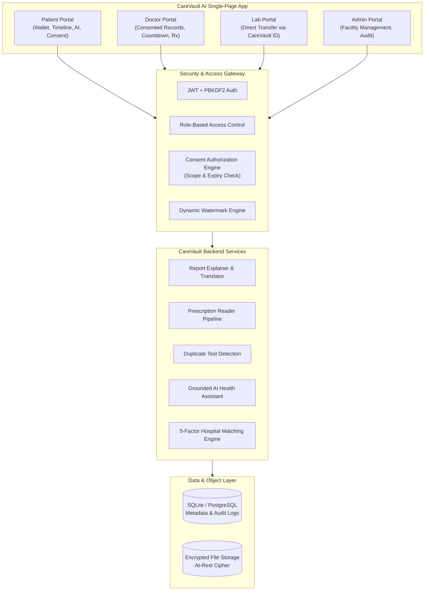

# CareVault AI 🛡️
> **"Your Health. Your Records. Your Control."**
> 
> **Developer & Author:** [@Prasanna-1401](https://github.com/Prasanna-1401)  
> **GitHub Repository:** [https://github.com/Prasanna-1401/carevault](https://github.com/Prasanna-1401/carevault)

CareVault AI is a production-style, patient-controlled digital health wallet and clinical decision-support ecosystem built for modern healthcare. It empowers patients to receive, organize, understand, and securely share their medical records while keeping patient privacy, safety guardrails, and cryptographic access control at the center.

---

## 🌟 Key Features & Capabilities

### 1. Patient-Controlled Digital Health Wallet
- **9 Standard Health Categories**: Lab Reports, X-rays, CT/MRI, Prescriptions, Discharge Summaries, Doctor Notes, Vaccination Records, Previous Treatments, and Other Documents.
- **Dual Perspectives**: Visual Category Card Grid & Interactive Chronological Timeline View.
- **Encryption at Rest**: Sensitive files encrypted at rest with temporary signed download and view tokens.
- **Direct Diagnostic Transfer**: Diagnostic labs directly push certified results to the patient's wallet via CareVault ID without gaining unauthorized access to prior records.

### 2. Clinical AI Decision Support (With Strict Guardrails)
- **AI Medical Report Explainer**: Translates complex diagnostic markers (CBC, HbA1c, KFT, X-rays, CT/MRI) into simple, structured language:
  1. What this report is
  2. Important terms explained
  3. Simple plain-language explanation
  4. What the test generally measures
  5. Questions to discuss with doctor
  6. Critical warning signs
- **AI Handwritten Prescription Reader**: Multi-stage OCR & stroke recognition pipeline:
  - Medicine identification, dosage extraction, and plain-language purpose.
  - Model confidence scoring.
  - **Critical Safeguard**: When confidence is low or handwriting is unclear, CareVault AI **refuses to guess** and instructs: *"We could not confidently identify this medicine. Please confirm with your doctor or pharmacist before taking it."*
- **Multi-Language Explanation Engine**: Instant explanation in 8 Indian languages: English, Telugu (తెలుగు), Hindi (हिन्दी), Tamil (தமிழ்), Kannada (ಕನ್ನಡ), Malayalam (മലയാളം), Marathi (मराठी), and Bengali (বাংলা), keeping drug names and dosage metrics medically precise.
- **AI Duplicate & Recent Test Detection**: Compares new orders against patient history within clinical observation windows (14–90 days). Emits mandated safety phrasing:
  > *"⚠️ Similar previous test found. Please discuss with your doctor whether the previous result is sufficient for the current clinical purpose or whether repeating the test is necessary."*
- **Conversational Health Assistant**: Grounded strictly in the authenticated patient's records. Actively deflects clinical diagnosis requests and blocks dosage alteration suggestions.
- **"Understand Your Health" Disease Awareness**: Educational condition reference (symptoms, risk factors, monitoring tests, lifestyle management, red flags).
- **Personalized Doctor Visit Questions**: Interactive checklist generating high-yield questions tailored to the patient's active conditions and test results.

### 3. Patient-Controlled Consent & Security
- **Granular Consent Requests**: Specify record categories (Labs, Rx, Scans, All), purpose (Treatment, Consultation, Emergency), and duration (15m, 30m, 60m).
- **Status Workflow**: `REQUESTED` ➔ `GRANTED` ➔ `REJECTED` / `REVOKED` / `EXPIRED`.
- **One-Time QR Code Sharing**: Generates a short-lived token QR code. **Rule**: QR codes contain **ONLY** a secure crypto exchange token &mdash; zero raw health data.
- **View-Only Access & Watermarking**: Providers view records with dynamic watermarks:
  `"Confidential - Viewed by [Provider Name] - [Timestamp]"`
- **Tamper-Evident Access History**: Immutable audit log recording all access requests, grants, rejections, revocations, and views.

### 4. Healthcare Discovery & 🚨 Emergency Mode
- **Smart Hospital Finder**: Maps natural language queries (*"I need kidney stone treatment"*) to medical specialties (*Urology, Lithotripsy*).
- **5-Factor Configurable Matching Engine**:
  - Specialty Match: 40%
  - Geospatial Distance (Haversine): 25%
  - Cost Range Fit: 15%
  - Insurance / Scheme Match: 10%
  - Facility Verification: 10%
  - Termed: **"Best Matches Based on Your Criteria"** (never "best hospital"). Shows transparent match reason badges.
- **Interactive Nearby Map**: Leaflet.js map with facility pins and direct contact links.
- **🚨 1-Tap EMERGENCY Mode**: High-priority triage screen showing nearest verified Level 1 Trauma centers, 24/7 ER numbers, ambulance dispatch (108/112), and one-click Emergency Medical ID.

---

## 🏛️ System Architecture



---

## 🔑 Demo Login Credentials

For hackathon judges and evaluators, a **1-click Role Switcher** is provided at the very top of the application navbar. You can also log in directly using:

| Role | Name | Email | Password | CareVault ID |
| :--- | :--- | :--- | :--- | :--- |
| **Patient** | Priya Sharma | `priya.sharma@example.com` | `patient123` | `CV-PAT-1001` |
| **Patient 2** | Rohan Verma | `rohan.verma@example.com` | `patient123` | `CV-PAT-1002` |
| **Doctor** | Dr. Rajesh Mehta (Cardio) | `dr.mehta@example.com` | `doctor123` | `CV-DOC-2001` |
| **Doctor 2** | Dr. Sunita Kapoor (Urology) | `dr.kapoor@example.com` | `doctor123` | `CV-DOC-2003` |
| **Diagnostic Lab** | Apex Central Diagnostics | `lab@apexdiagnostics.com` | `lab123` | `CV-LAB-3001` |
| **Administrator** | System Admin | `admin@carevault.ai` | `admin123` | `CV-ADM-4001` |

> *Note: All patient records, test results, doctor profiles, and facilities in this repository are **100% synthetic demo data** created specifically for evaluation.*

---

## 🚀 Quick Start Guide

### 1. Launch Server (Windows)
Double-click `run.bat` or execute in PowerShell:
```powershell
.\run.ps1
```
Or run directly using Python virtual environment:
```powershell
.\venv\Scripts\uvicorn.exe app.main:app --host 127.0.0.1 --port 8000 --reload
```

### 2. Open Application
Open your web browser and visit:
👉 **`http://127.0.0.1:8000`**

### 3. Run Automated Integration Test Suite
```powershell
.\venv\Scripts\python.exe test_suite.py
```
*(All 19 automated integration tests verify end-to-end functionality across all 31 specifications).*

---

## 🛡️ Healthcare Safety Compliance Summary

1. **Non-Diagnostic Rule**: CareVault AI identifies itself as an informational decision-support tool and actively blocks attempts to diagnose medical conditions.
2. **No Dosage Changes**: The AI system strictly prohibits advising patients to stop medications or alter physician dosages.
3. **Handwriting Uncertainty Guard**: If prescription handwriting confidence falls below clinical thresholds (<85%), the system refuses to guess and warns the patient to verify with a pharmacist.
4. **Non-Biased Facility Matching**: Facilities are ranked according to objective patient criteria and labeled *"Best matches based on your criteria"* rather than claiming any hospital is objectively "the best".
5. **No Medical Data in QR Codes**: QR codes strictly contain short-lived cryptographically signed exchange tokens.
